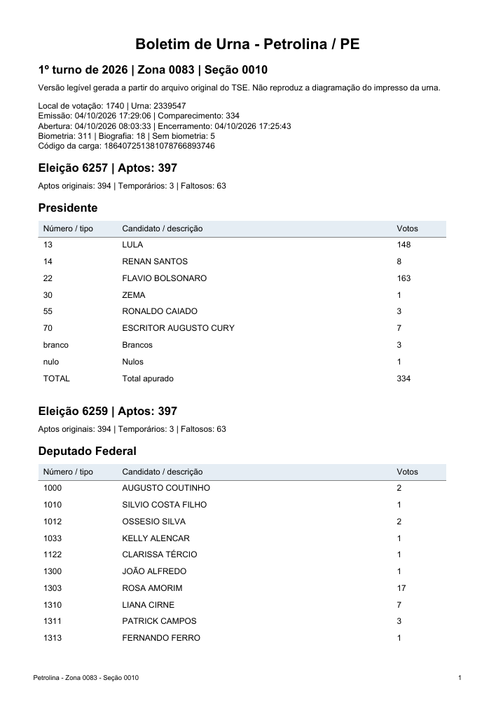
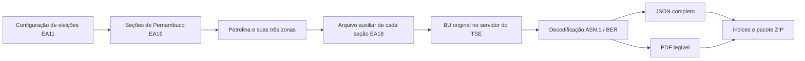

# Boletins de Urna de Petrolina · 2026

**Download automático dos BUs oficiais do primeiro turno, com os arquivos originais preservados e versões em PDF para leitura.**


O projeto surgiu para resolver um trabalho repetitivo: abrir o portal Resultados do TSE, selecionar uma zona e uma seção, baixar o boletim e repetir centenas de vezes. O script consulta os mesmos arquivos oficiais diretamente, organiza os BUs por zona e produz documentos legíveis sem exigir cliques para cada seção.

## Baixar os arquivos prontos

Na [versão v1.0.0](https://github.com/theuzszz/bus-petrolina-2026/releases/tag/v1.0.0), escolha:

| Pacote | Conteúdo | Como usar |
| :--- | :--- | :--- |
| `BUs_Petrolina_2026.zip` | PDFs, BUs originais `.dat`, JSONs decodificados e índices | Extraia e abra `indice.html` dentro da pasta |
| `BUs_Originais_Petrolina_2026.zip` | Somente os `.dat` originais, separados por zona e seção | Use para guardar ou processar os BUs sem os PDFs |
| `Script_BUs_Petrolina.zip` | Código, especificação ASN.1 e dependências | Execute seguindo as instruções abaixo |

Os PDFs são **representações dos dados extraídos dos BUs**. Não reproduzem o leiaute do papel impresso pela urna e não são PDFs emitidos pelo TSE.

## Cobertura da coleta

Coleta realizada em **5 de outubro de 2026**, referente ao **primeiro turno de 4 de outubro de 2026**, em Petrolina/PE, município TSE **25216**.

| Zona | Registros de seção | BUs originais / PDFs | Seções agregadas |
| :---: | ---: | ---: | ---: |
| 0083 | 242 | 239 | 3 |
| 0144 | 245 | 243 | 2 |
| 0145 | 252 | 248 | 4 |
| **Total** | **739** | **730** | **9** |

Uma seção agregada compartilha o BU da seção principal. O índice indica esse vínculo; não há um BU independente para cada uma das nove agregadas. A coleta concluída não registrou pendências.

## Executar no Windows

É necessário **Python 3.11 ou mais recente** e acesso à internet. O download público dos arquivos não exige login no TSE.

Baixe o [código do repositório](https://github.com/theuzszz/bus-petrolina-2026/archive/refs/heads/main.zip) ou o pacote de script da release. Extraia e abra o CMD na pasta que contém `baixar_bus.py`.

```cmd
py -m venv .venv
.venv\Scripts\python.exe -m pip install -r requirements.txt
.venv\Scripts\python.exe baixar_bus.py
```

Se `py` não estiver disponível, use `python` no primeiro comando. Para Linux/macOS:

```bash
python3 -m venv .venv
.venv/bin/python -m pip install -r requirements.txt
.venv/bin/python baixar_bus.py
```

O programa imprime o progresso a cada 25 seções, cria `BUs_Petrolina_2026/` e gera o ZIP ao lado do script. Ao final, consulte `resumo.json`: erros ou situações sem conversão aparecem em `pendencias`. Não considere a execução completa apenas porque o programa terminou.

## O que é gerado

```text
BUs_Petrolina_2026/
├── indice.html                  # Acesso aos PDFs por zona e seção
├── indice.csv                   # Lista de seções e vínculos de agregação
├── resumo.json                  # Contagem e pendências da execução
├── configuracao_secoes.json     # Configuração de Pernambuco recebida do TSE
├── zona_0083/
│   ├── o03220pe2521600830010-bu.dat  # BU original da seção 0010
│   ├── BU_0083_0010.pdf             # Versão legível
│   ├── BU_0083_0010.json            # Conteúdo integral decodificado
│   └── BU_0083_0010_aux.json        # Metadados e endereço dos arquivos
├── zona_0144/
└── zona_0145/
```

O pacote de originais da release usa `zona_0083/secao_0010/arquivo.dat`. O script de download gera a estrutura por zona mostrada acima; a separação adicional por seção foi feita na preparação do pacote.



## Como funciona



O script usa a biblioteca **asn1tools** para interpretar o BU segundo `bu.asn1`, publicado pelo TSE, e **ReportLab** para montar os PDFs. Os nomes dos candidatos vêm dos arquivos municipais de resultados; as quantidades de votos vêm dos BUs. Quando um nome não consta nessa lista, o número do candidato é preservado.

O código foi escrito para este projeto, com auxílio do Codex. Não é uma ferramenta oficial do TSE. A especificação ASN.1 é um arquivo de terceiros e está identificada em [Fontes e atribuições](docs/FONTES.md).

## Conferências realizadas

- Identificação de fase oficial, pleito, município, zona e seção durante a decodificação.
- Existência de 730 PDFs e respectivos originais, com todas as agregadas vinculadas a um PDF no índice.
- Somas dos votos de todos os cargos conferidas na coleta: uma escolha por eleitor para os demais cargos e duas para senador.
- Comparação independente da zona 0083: **257 downloads anteriores**, abrangendo **239 seções distintas**, tiveram SHA-256 idêntico aos arquivos da automação. Os arquivos adicionais eram downloads repetidos.
- Verificação da integridade do ZIP e inspeção visual de PDFs de exemplo.

O SHA-256 identifica os bytes baixados; **não substitui a validação da assinatura criptográfica do BU**. Este projeto não valida essa assinatura. As conferências acima descrevem a coleta publicada; o script original não automatiza todas elas em novas execuções.

Para repetir a conferência local de identificação, somas e cobertura, o repositório inclui `validar_coleta.py`:

```cmd
.venv\Scripts\python.exe validar_coleta.py BUs_Petrolina_2026
```

O verificador interrompe ao encontrar pendências, PDFs ausentes, seções duplicadas, identificação divergente, soma inconsistente ou vínculo de agregação inválido. Quando conclui, gera `SHA256SUMS.txt` com os resumos dos originais. Essa verificação também foi executada sobre o conjunto antes da publicação.

## Adaptar para votos e cálculos

É possível usar os JSONs já decodificados para selecionar candidatos que tiveram exatamente X votos, pelo menos X votos ou que participem de uma fórmula. O script publicado **não aplica filtros de candidatos** e mantém os BUs completos.

Para totais municipais, agrupe por **eleição + cargo + número do candidato**, conte cada seção principal uma vez e selecione votos de tipo `nominal`. Não some novamente as seções agregadas. Veja o caminho dos campos, exemplos e cuidados em [Adaptação para análises](docs/ADAPTACAO.md).

## Limitações e reprodução

- Escopo fixo: Petrolina, três zonas e primeiro turno de 2026. Alterar apenas um número não torna o script genérico para outras eleições.
- O resultado remoto pode mudar após retransmissões ou novas totalizações. A release representa uma coleta em uma data específica.
- Arquivos `.dat` existentes são reutilizados pelo nome. Para uma coleta atualizada, execute em uma pasta nova; o script não compara o hash recebido na nova consulta com o conteúdo local já baixado.
- Há três tarefas de download simultâneas e até três tentativas por requisição. Em caso de indisponibilidade, consulte as pendências e as orientações do TSE.
- Alguns números de candidatos não tiveram nomes encontrados na lista de resultados usada na coleta. Seus votos são mantidos.
- O JSON preserva dados e hashes presentes no BU; valores binários são representados em hexadecimal.

## Contribuir

Abra uma issue com a seção, o comportamento observado e uma descrição reproduzível. Sugestões úteis incluem atualização de cache por hash, configuração de outros municípios, validação criptográfica e filtros de análise. Não inclua credenciais ou caminhos pessoais nos relatos.

O código do projeto usa licença MIT. A especificação do TSE e os dados eleitorais mantêm sua origem e não são relicenciados por este repositório.
